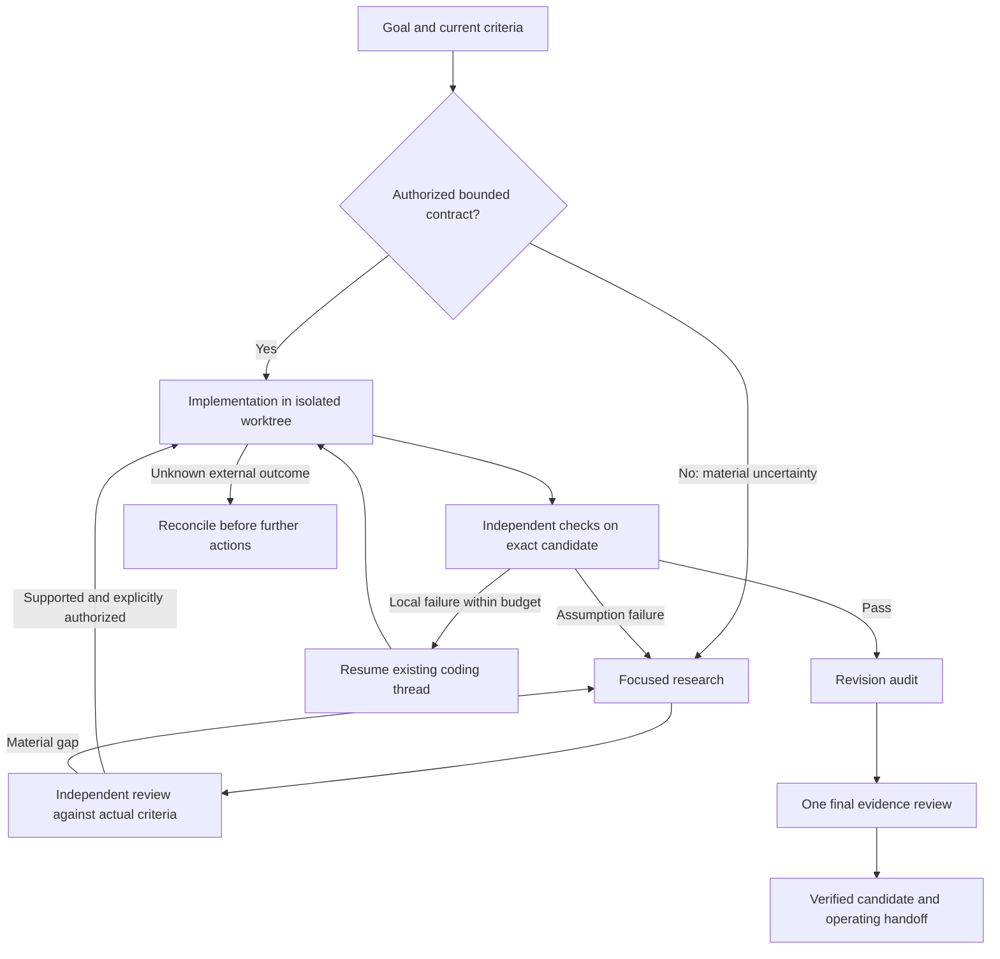

# Adaptive agent execution

The main source of avoidable overhead was requiring research and repeated manager
round trips for a task whose contract was already explicit. The same Codex worker
performed the code change, but it waited for extra planning, duplicated state and
research reviews that sometimes judged a future patch instead of the current defect.

The supervisor now starts an explicitly authorized `basis: direct` contract when
exactly one is ready. It preserves the allowed paths, checks, attempt limits,
revision fences, isolated worktree and independent audit. Local repairs resume the
same native thread. The manager reviews the consolidated evidence once at the end.
An unknown defect still needs focused research. Research-only campaigns stay read-only.
If a confirmed completed turn leaves an out-of-scope artifact, a bounded repair can
restore only its own changes before any candidate commit or verification. The
allowlist stays unchanged. Unknown external outcomes still require reconciliation;
revoked work can be reconciled read-only without execution or acceptance.



Independent read-only questions can run in one wave of two or three jobs. The
manager must explain why no result is a prerequisite for a peer. Each researcher
and evaluator still charges the saved role-run budget; campaign dollar reservations,
deadlines, cancellation and revision fences remain enforced. This is bounded
concurrency, not unrestricted agent spawning.

The evaluator receives the goal, current criteria and review stage. For example,
source evidence that a retry loop is missing can support a bounded fix. The future
candidate must then pass executable retry checks. Unspecified behavior is recorded
as nonblocking unless it creates a concrete material risk. A supported verdict with
explicit blocking questions is rejected deterministically.

The brain receives one current state and relevant durable dialogue. Complete criteria
and policy survive compaction. Recent reports appear once; older originals remain
available by task, research or implementation ID. Scope-relevant prior findings rank
ahead of unrelated recent records, retaining freshness flags and rejected hypotheses.
The model's action enum excludes unavailable implementation, audit and legacy actions.

## Why these mechanisms fit

The direct route reuses the repository's existing `Implementations.auth`, `verify`
and `audit` contracts; it does not replace them with a model's confidence. The native
thread reuse follows the documented Codex [thread/resume lifecycle](https://developers.openai.com/codex/app-server/)
(reference checked 2026-10-19). The research wave reuses `Supervisor.submit` and
atomic budget updates. These are concrete local conventions and documented API use.
The routing policy and width of three are design choices, not universal standards.

The tradeoff remains explicit: a single worker may be faster for a tiny task. A
manager must earn its extra cost through verification, coordination or investigation.
The [recorded comparison](experiments/adaptive-comparison.md) separates these costs;
it does not claim production benefit or general multi-agent superiority.

## Monitoring after rollout

No deployment or production monitoring was performed for this change. The following
is a proposed operating plan. The repository/service maintainer owns rollout; a named
operational owner and production alert destinations remain to be assigned.

Start with opted-in direct contracts on isolated, non-production goals. Preserve the
research route for unknown contracts. Compare the same task classes and model/budget
settings; fixtures alone are insufficient for broad adoption. Review daily during
the first week, then weekly after stable evidence. The initial observation target is
at least 30 comparable goals per route/task class; it is a sampling plan, not proof
of statistical significance.

| Signal | Existing evidence | Review or stop condition |
| --- | --- | --- |
| Accepted outcome | `verifications`, `completion_audits`, current goal revision | Any completion with a failed mandatory check is an immediate stop/investigation |
| Unauthorized or stale action | Authorization/revision checks; `scope_violation`, `decision_rejected`, `stale_result` | Any accepted scope violation, write outside the isolated workspace, or accepted stale result: stop new work and reconcile. Rejected artifacts from a confirmed completed turn may receive bounded cleanup |
| End-to-end latency | Benchmark `wall_seconds`; task start/finish times | Compare p50/p95 by task class; investigate sustained regression against a matched baseline |
| Coordination cost | `manager_turn.seconds`, `context_bytes`, manager turn count; `research_role` | Investigate repeated planning for direct contracts or context growth without new evidence |
| Token use | `usage` and cumulative native `runtime_usage_snapshot` | Compare by role/model; use the latest native total per thread, never sum cumulative snapshots |
| Repair/reconciliation | `implementation_turn.resumed`, implementation attempts/status | Local repair should reuse its thread; unknown outcomes must never be blindly replayed |
| Parallel work and spend | `research_wave`, worker start/finish intervals, `research_limits`, `spending_requests` | Width above three or consumed budget above its saved limit: immediate stop/investigation |
| Quality and false blockers | Quality reports, evaluation blocking/nonblocking questions, final decisions | Sample accepted and rejected work against the actual contract; investigate invented prerequisites or unsupported PASS claims |

Example read-only query for coordination telemetry (seconds and UTF-8 context bytes):

```sql
SELECT goal_id, datetime(created, 'unixepoch') AS observed_utc,
       json_extract(detail, '$.seconds') AS seconds,
       json_extract(detail, '$.context_bytes') AS context_bytes,
       json_extract(detail, '$.action') AS action
FROM activity WHERE kind = 'manager_turn' ORDER BY created DESC LIMIT 100;
```

Thresholds beyond the hard correctness/scope/budget invariants must be calibrated
against the service's baseline before alerts are enabled. No alert, dashboard query
or rollout toggle is implied to be installed by this document.

To roll back, pause affected goals through the existing control interface, stop
issuing direct authorizations, and reconcile all in-flight/uncertain native turns.
Preserve the state database, evidence logs and worktrees. Resume compatible
research-based work or deploy a corrected release after review. Do not blindly
downgrade a live database containing direct contracts into an older runtime that
cannot parse them, replay unknown actions, or discard candidate evidence.
