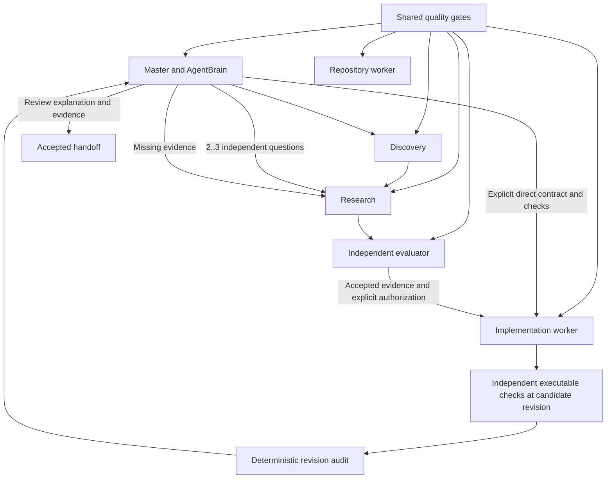

# Role-specific quality gates

Opening a PR or finishing a worker turn is not proof that an engineering goal is met.
Each role must deliver evidence appropriate to its responsibility. The shared prompt
is `instructions/QUALITY_GATES.md`; `omnitrix/prompts.py` composes it with these roles.

| Role | Prompt | Required outcome | Follow-through |
| --- | --- | --- | --- |
| Master manager | `MANAGER.md` | Assign a bounded finish line; independently accept or return evidence against current criteria | Owner, remaining gate, next action; distinguish candidate, deployment and measured benefit |
| Research campaign manager | `CAMPAIGN.md` + brain/knowledge | Review independent findings across the saved scope without exceeding persistent budgets | Read-only investigation, remaining coverage and refresh trigger |
| Agent brain | `BRAIN.md` + `KNOWLEDGE.md` | Traceable decisions using current facts, uncertainty, rejected hypotheses and valid IDs | Refresh stale evidence; preserve contradictions and decision history |
| Conversational manager | `CHAT.md` + brain/knowledge | Accurate, concise status and explicit policy proposals | Existing proposal/acceptance workflow; no implied completion |
| Discovery | `DISCOVERY.md` | Sourced map, coverage gaps, ranked bounded opportunities | Next discriminating question and map refresh trigger |
| Research | `RESEARCH.md` | Falsifiable hypothesis, method, support/counterevidence, uncertainty and actionable conclusion | Validation experiment and evidence that would invalidate the conclusion |
| Primary investigator | `RESEARCH.md` + `INVESTIGATOR.md` + knowledge | Investigate directly and submit one bounded hypothesis with observed sources | Independent review; no repeated availability audit or invented inefficiency |
| Research completion reviewer | `GOAL_REVIEW.md` | Independently map the original objective and each criterion to verified findings | Validation/invalidation trigger, scope limits and exact remaining gap |
| Independent evaluator | `EVALUATION.md` | Claim-to-source assessment, visual/data checks, defensible verdict | Exact correction or missing prerequisite; no self-certified support |
| Repository inspection | `WORKER.md` | Read-only findings with file/revision evidence and useful explanation | Scope gap, next check or freshness trigger |
| Implementation | `IMPLEMENTATION.md` | Why the fix works, correctness/test evidence, measured versus estimated impact and practice comparison | Rollout, baseline, metrics/queries, thresholds, window, owner and rollback |

`AgentBrain` is the manager's existing decision agent, not an additional agent process.
Its brain/knowledge guidance applies to both planning and conversational recall.
The implementation verifier and final audit are deterministic Python code, not LLM
roles; their executable acceptance contracts remain in force.

This diagram shows responsibilities and review flow, not an automatically executed
task graph. The manager chooses the next authorized bounded action. Deployment and
production observation are separate actions; this system does not perform them.
The direct route runs verification and audit before the single final manager review.
The research route can request its audit separately. Missing authorization, stale
evidence, failed checks and uncertain external outcomes still block execution.

## Review contract

`Handoff`, `DiscoveryReport`, `ResearchReport`, `Evaluation` and
`ImplementationHandoff` and `GoalReview` carry a bounded Markdown `quality_report`. It holds narrative,
diagrams, tables and gate assessments without putting prose in evidence-ID arrays or
creating files outside authorized paths. Reports persist through the existing JSON
task/research/message records and export paths. Manager decisions/chat use their
existing rationale, instructions and response fields to summarize the review.

For substantive work the report covers:

1. Outcome and scope; explicit acceptance criteria.
2. Why the result works, with a concrete example and tradeoffs.
3. Traceable evidence and useful visuals. Measured charts identify values/query,
   units, population and time window. Diagrams label unverified relationships.
4. Applicable local patterns or authoritative practice, with citations and deviations.
5. Validation, contrary evidence, uncertainty and unrun checks.
6. Role-specific follow-through and individual gate outcomes.

PASS requires evidence; RETURN names feasible missing work; BLOCKED names a missing
prerequisite plus completed work and next owner/action. N/A needs a task-specific
reason and cannot waive an explicit criterion. A trivial task can use a compact table
or explain why a visual adds no information. Missing data is never a license to draw
a fictional chart. A source outside the allowed scope remains a gap.

## Different finish lines

For a latency hypothesis, a research report might map the suspected request path,
compare actual timing samples, identify confounders, and recommend an experiment that
would reject the proposed cause. It must not claim deployed savings or manufacture
a PR to pass. If only configuration is available, the report must say latency impact
is unmeasured and name the missing measurement.

For an implemented latency fix, the worker must explain the mechanism and invariants,
show comparable before/after measurements for any improvement claim, link test evidence,
and specify the production metric/query, baseline, proposed thresholds, observation
window, owner and rollback. An unspecified threshold or owner remains open. Passing
local tests does not establish production benefit.

The master reviews the actual evidence package instead of copying the worker's PASS.
The brain retains the evidence's scope and age so later decisions do not turn a
conditional finding into a universal fact. Neither role grants itself new permissions.

## Enforcement and compatibility

SDK roles receive composed `Agent.instructions`. Codex App Server start/resume uses
`developerInstructions`, selecting implementation only for a write-enabled task.
The legacy Node SDK bridge receives the same read-only worker instructions through
the supported `developer_instructions` configuration. Task text is separate from
these prompts. Missing/empty prompt files or unknown roles fail loudly.

Prompts require the qualitative evidence gates; independent evaluators and the master
judge them. Deterministic code still checks source IDs/freshness, scopes, authorizations,
budgets, candidate revisions and executable criteria. Text presence or a PASS label
alone cannot mechanically prove a chart accurate or a monitoring plan sufficient.
The audit does not inspect prose, configure alerts, deploy, or watch production.

One final evidence package is assembled from focused specialist reports. The HTML
`omnitrix report` export exposes quality reviews ahead of expandable raw provenance;
the optional `docs` extra renders safe Markdown tables. Source/model HTML remains
escaped. Wheel distributions include every role prompt. Manager context contains
one current snapshot, complete criteria, compact recent results and recall tools;
older snapshots are not replayed as dialogue. See [execution and monitoring](ADAPTIVE_EXECUTION.md).

Existing persisted reports without `quality_report` deserialize as empty and must be
treated as unreviewed by the manager. New Codex output schemas require the field;
the SDK applies strict structured output schemas as well. This preserves old records
without rewriting past evidence or accepting old work under new criteria silently.
New and resumed invocations load the current prompt files. In-flight turns retain
their original instructions until a later invocation or explicit steering.
