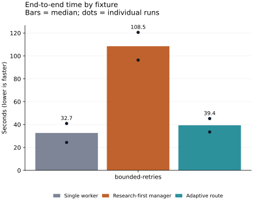
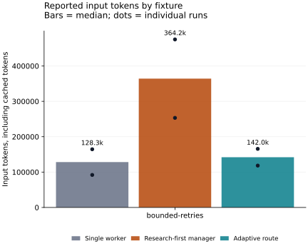

# Recorded adaptive execution comparison

The comparison uses the same fixture trees, executable contracts and coding model
for all arms. The adaptive route removes prerequisite research for an explicitly
authorized bounded contract while retaining independent verification and final review.
The research-first arm includes the revised prompts and evaluation contract; it is
not an untouched historical implementation. Single-worker state may remain `active`
because that arm has no manager lifecycle; its candidate is independently scored.

| Route | Runs passing checks | Criteria passed | Median seconds | Total seconds | Input tokens | Output tokens | Token coverage |
| --- | --- | --- | --- | --- | --- | --- | --- |
| Single worker | 2/2 | 4/4 | 32.7 | 65.4 | 256,545 | 4,740 | Complete |
| Research-first manager | 2/2 | 4/4 | 108.5 | 217.0 | 728,384 | 16,323 | Complete |
| Adaptive route | 2/2 | 4/4 | 39.4 | 78.8 | 284,028 | 6,009 | Complete |

Tokens are reported usage, including cached input, not billed dollar costs. The
manager uses gpt-5.4 and all coding arms use gpt-5.3-codex with medium reasoning.
Run order rotates across trials; two rotations do not fully balance order effects.
Role timings are retained in the raw records;
parallel role spans can overlap and must not generally be added as wall time.

These are two repetitions of one known, small Python fixture, with acceptance
checks visible to workers. No held-out or production workload was measured. Shared
host/network/model latency varies, and 2 runs per arm do not establish statistical
significance or general architecture superiority. The adaptive route can remain
slower than a single worker: its independent verification and final manager review
have a real cost. Its measured benefit here is relative to unnecessary research-first
coordination. Compare larger and open-ended tasks before expanding rollout.

An earlier, broader exploratory run exposed inconsistent write-scope enforcement:
a research-first candidate was blocked for an unintended file, while a single-worker
candidate with the same mistake was scored without that scope check. Those original
18 results and the retrospective scope audit are preserved in
[exploratory evidence](adaptive-exploratory/README.md). They are not the final fair
comparison. The runs shown here use the corrected harness with the same write-scope
check on all arms and a bounded repair path for confirmed completed worker turns.

The frozen comparison checkpoint is `94dabcd4e451d2631a58d00eecde8eaeeb5167fa`.
These timings precede the subsequent integration of upstream research recovery and
completion-review changes. They remain measurements of this frozen checkpoint; the
integrated runtime has separate regression, package and live smoke results below.
The runtime, native recovery, live parallel research and package delivery are validated separately in
[validation evidence](adaptive-validation.json). See the readable [native recovery review](adaptive-recovery.html) and [parallel research evidence](adaptive-wave.html). The initial failed routing run is
preserved in [calibration evidence](adaptive-calibration.json); it is excluded from
this fixed comparison after the unavailable-action bug was corrected.

[Machine-readable values and stage timings](adaptive-comparison.json) ·
[Mechanism, practice references, monitoring and rollback](../ADAPTIVE_EXECUTION.md)

## Candidate and check evidence

Each candidate patch is relative to the identical fixture tree. Check logs come from
independent scoring of an immutable candidate checkout; they are not worker claims.

| Trial | Fixture | Route | Seconds | Criteria | Artifacts |
| --- | --- | --- | --- | --- | --- |
| trial-0 | bounded-retries | Single worker | 41.0 | 2/2 | [candidate](adaptive-evidence/trial-0/bounded-retries/single/candidate.patch) · [check 1](adaptive-evidence/trial-0/bounded-retries/single/check-0.log) · [check 2](adaptive-evidence/trial-0/bounded-retries/single/check-1.log) |
| trial-0 | bounded-retries | Research-first manager | 120.6 | 2/2 | [candidate](adaptive-evidence/trial-0/bounded-retries/manager/candidate.patch) · [check 1](adaptive-evidence/trial-0/bounded-retries/manager/check-0.log) · [check 2](adaptive-evidence/trial-0/bounded-retries/manager/check-1.log) · [quality review](adaptive-evidence/trial-0/bounded-retries/manager/quality-review.md) |
| trial-0 | bounded-retries | Adaptive route | 33.6 | 2/2 | [candidate](adaptive-evidence/trial-0/bounded-retries/adaptive/candidate.patch) · [check 1](adaptive-evidence/trial-0/bounded-retries/adaptive/check-0.log) · [check 2](adaptive-evidence/trial-0/bounded-retries/adaptive/check-1.log) · [quality review](adaptive-evidence/trial-0/bounded-retries/adaptive/quality-review.md) |
| trial-1 | bounded-retries | Single worker | 24.4 | 2/2 | [candidate](adaptive-evidence/trial-1/bounded-retries/single/candidate.patch) · [check 1](adaptive-evidence/trial-1/bounded-retries/single/check-0.log) · [check 2](adaptive-evidence/trial-1/bounded-retries/single/check-1.log) |
| trial-1 | bounded-retries | Research-first manager | 96.4 | 2/2 | [candidate](adaptive-evidence/trial-1/bounded-retries/manager/candidate.patch) · [check 1](adaptive-evidence/trial-1/bounded-retries/manager/check-0.log) · [check 2](adaptive-evidence/trial-1/bounded-retries/manager/check-1.log) · [quality review](adaptive-evidence/trial-1/bounded-retries/manager/quality-review.md) |
| trial-1 | bounded-retries | Adaptive route | 45.3 | 2/2 | [candidate](adaptive-evidence/trial-1/bounded-retries/adaptive/candidate.patch) · [check 1](adaptive-evidence/trial-1/bounded-retries/adaptive/check-0.log) · [check 2](adaptive-evidence/trial-1/bounded-retries/adaptive/check-1.log) · [quality review](adaptive-evidence/trial-1/bounded-retries/adaptive/quality-review.md) |
