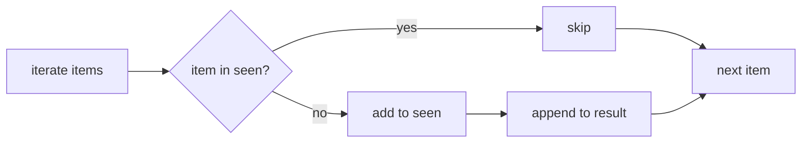

# Manager acceptance review

Completed: event deduplication was updated in `service.py` to preserve first-occurrence order without mutating input while meeting the linear-equality-check requirement. Evidence: candidate `a1abb4105bcba6fe351597339eeb69597bbff8f8`; verification logs `6de1342798514546bc90aa50a1ac68b7.log` and `3d5114f4ddc9429a8267846f5dc0080c.log`. Next step if desired: merge or independently re-run the two supplied checks against the candidate worktree.

# Implementation worker evidence

Outcome: Replaced list-membership dedup with set-tracked dedup in `service.py:1` to keep first-occurrence order while avoiding quadratic equality comparisons.

Why it works:
- Original failure cause: `if item not in result` scans the growing `result` list each iteration, causing O(n^2) equality checks in worst-case unique inputs.
- Change: maintain `seen` set for membership and append only first-seen items.
- Before/after example: with `[3,1,3,2]`, both versions return `[3,1,2]`; updated version still does not mutate `items` and preserves first-seen order.
- Invariant preserved: output order is the order of first appearances; input remains unchanged.

Evidence / visual:

| Criterion | Baseline status | Post-change result | Evidence |
|---|---|---|---|
| Preserve first occurrence order without mutating input | PASS | PASS | `check_0.py` output `criterion passed` |
| Linear number of equality checks | FAIL | PASS | `check_1.py` output `criterion passed` |

Flow diagram (changed logic):

Takeaway: membership is now hash-based (`seen`) rather than linear scan (`result`), removing the reliability risk of pathological comparison growth.

Practice and tradeoffs:
- Uses standard Python order-preserving dedup pattern (`set` + `list`) aligned with existing simple function style.
- Tradeoff: requires hashable items (same practical requirement implied by the provided linear-check contract using `__hash__`).
- Alternative considered: `dict.fromkeys(items)` is concise but less explicit for control and future extension.

Validation and limitations:
- Ran both authoritative acceptance checks exactly as supplied.
- Scope constrained to `service.py` only; no public API or signature changes.
- No additional performance benchmark numbers beyond contract checks; linearity claim validated by executable acceptance criterion.

Follow-through:
- Deployment/rollback: N/A (local code change only, no deployment actions performed).
- Adoption check: independent reviewer reruns `check_0.py` and `check_1.py` against candidate path; rollback is reverting `service.py` to prior revision if any regression appears.

Gate outcomes:
- Finish line definition: PASS
- Why/mechanism explained: PASS
- Evidence readability (table + diagram): PASS
- Established practice comparison: PASS
- Validation with executable checks: PASS
- Follow-through plan: PASS
