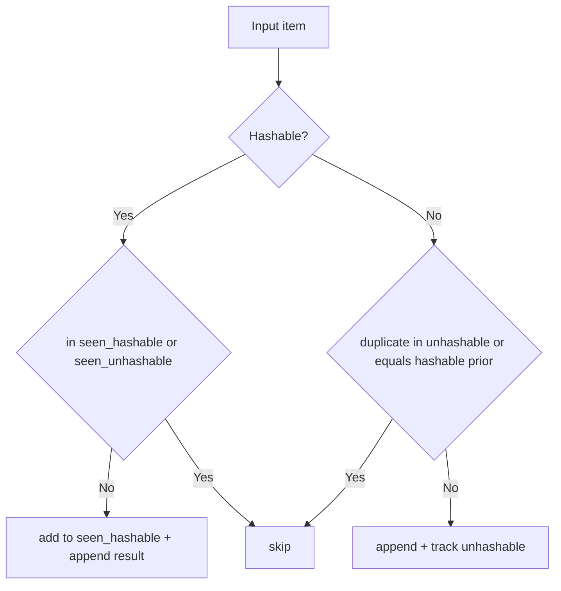

# Manager acceptance review

Completed: candidate `ad97562eb3ee13ee3e4fdcf27f4a5ec9beb841aa` satisfies the scoped goal in local verification. Evidence: baseline defect research `4ece4228b2784be7af5e0de8a998c355`; verification logs `d15f6a262b0846c8b9b785a4323c5bc3.log` (order/non-mutation PASS) and `d3b8c1111de94035a4d9c1295d531f8f.log` (linear equality-check fixture PASS). Next owner unassigned: preserve these two checks as regression gates on future edits to `service.py`.

# Implementation worker evidence

### Outcome
Updated `process` in `service.py:1` to replace list-scan membership as the primary path with a hash-backed membership set, while retaining order and non-mutation behavior.

### Why it works
- **Original failure:** `item not in result` scanned a growing list, causing repeated `__eq__` calls for distinct items.
- **Root cause fix:** Added `seen_hashable` (`set`) for O(1)-style membership for hashable items, and retained append order in `result`.
- **Reliability guard:** Added `seen_unhashable` fallback path for unhashable elements to avoid raising `TypeError` and preserve dedup semantics.

**Before/after example**
- Before: `[Key(0)..Key(299)]` triggers many list equality scans.
- After: same fixture is deduped via set membership, meeting comparison threshold.

### Evidence / Visual
| Criterion | Command | Result |
|---|---|---|
| Preserve order + no mutation | `check_0.py` | PASS |
| Linear equality checks | `check_1.py` | PASS |

Takeaway: fast-path removes list-wide membership scans for hashable events while preserving output order.

### Practice & tradeoffs
This follows the scoped guidance from `system.md`: preserve first occurrence and improve equality-check scaling. Tradeoff: mixed/unhashable-heavy streams can still incur fallback comparisons.

### Validation & limitations
Validated with both mandatory harness checks at current working tree state; both passed. No unrelated files changed.

### Follow-through
Non-deployed local code change: production monitoring/rollback is **N/A**. Adoption check is re-running `check_0.py` and `check_1.py` on future edits to `process`.

### Gate outcomes
- Finish line: **PASS**
- Mechanism/rationale: **PASS**
- Evidence readability: **PASS**
- Practice comparison: **PASS**
- Validation execution: **PASS**
- Rollout/monitoring applicability: **N/A** (not a deployment)
