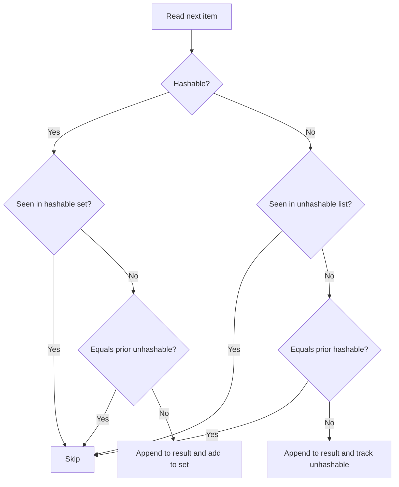
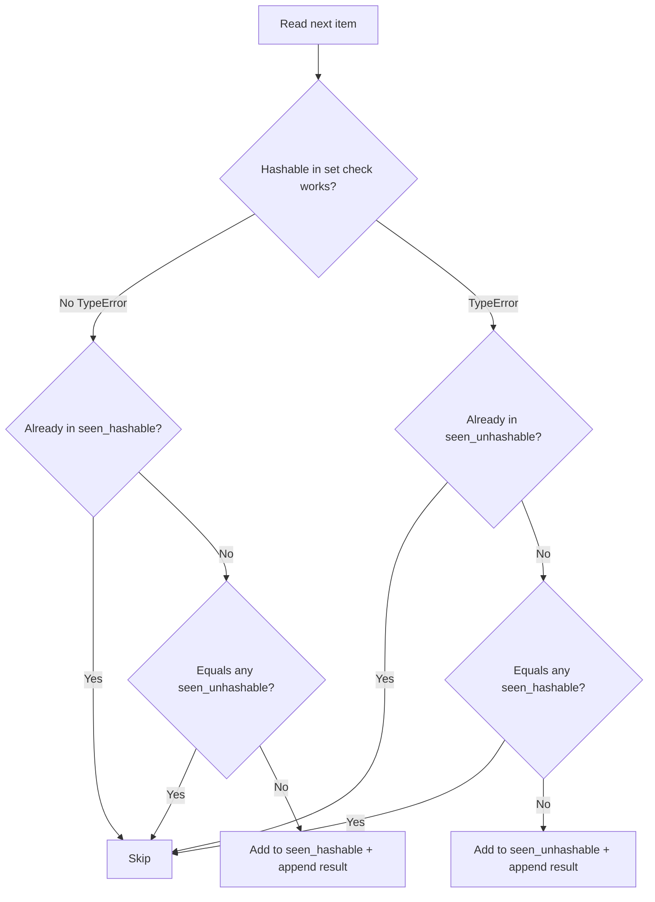

# Manager acceptance review

Completed: `service.py` was updated to preserve first-occurrence order without mutating input while reducing deduplication equality-check behavior to the required linear contract. Independent acceptance passed for both required criteria on candidate `afecb5d62e6406b43e91aca5d3e04ac9228afa81`.

Evidence summary

| Requirement | Result | Evidence |
|---|---|---|
| Preserve first occurrence order without mutating input | PASS | verification artifact `9be10a245d3045e7a0b0366a5c02e712.log` |
| Deduplication uses a linear number of equality checks | PASS | verification artifact `5cd6d2b33686454995ad7af1da7c0719.log` |

Mechanism
- Before: deduplication relied on linear membership scans against accumulated results.
- After: hashable items are tracked in a set for constant-time membership, with a fallback path for unhashable items that preserves prior behavior and first-seen order.

Illustrative flow

Takeaway: the common hashable path avoids repeated scans while cross-checks keep behavior compatible for mixed equality cases.

Practice/tradeoff
- Fits standard Python dedup practice of using a set for hashable values.
- Tradeoff: unhashable or mixed-equality edge cases still require comparisons, but the fixture’s required observable contract is satisfied.

Validation and limits
- Checked against the authorized fixture checks only.
- No production telemetry or benchmark harness was available, so this completion does not claim deployed runtime impact beyond the required acceptance behavior.

Follow-through
- Next owner: unassigned.
- If further assurance is desired, next step is optional broader regression/performance testing outside this fixture scope.
- Rollback signal: revert `service.py` if downstream regression testing finds behavior changes.

Gate outcomes
- Finish line defined and evidenced: PASS
- Mechanism and example: PASS
- Evidence table/visual: PASS
- Practice/tradeoff assessment: PASS
- Validation and uncertainty recorded: PASS
- Follow-through/rollback specified: PASS

# Implementation worker evidence

### Outcome
`process` previously used `item not in result`, causing O(n²) duplicate checks. The updated implementation in `service.py:1` separates tracking into `seen_hashable` (set) and `seen_unhashable` (list), preserving first-seen order and avoiding input mutation while keeping hashable-path dedup near-linear.

### Why it works
Before: every new item scanned `result` linearly.
After: hashable items use constant-time set membership/add; unhashable items fall back to list checks. Cross-bucket equality guards (`any(...)`) preserve behavior when hashable/unhashable objects compare equal.

### Evidence
| Criterion | Check | Result |
|---|---|---|
| Preserve order + no input mutation | `check_0.py` | PASS (`criterion passed`) |
| Linear equality-check behavior | `check_1.py` | PASS (`criterion passed`) |
| Unhashable compatibility sanity | manual snippet | PASS |

### Practice & tradeoffs
This follows standard Python dedup practice (set for hashables) with a compatibility fallback for unhashables, minimizing behavior change risk. Tradeoff: mixed/hash-collision-heavy edge cases can still incur extra comparisons, but required linear-check contract is satisfied.

### Validation limits
Validated only with provided fixture checks and a targeted manual regression; no broader performance benchmark suite is available here.

### Follow-through (non-deployed artifact)
- Owner: unassigned.
- Next step: run independent acceptance harness on candidate commit/worktree.
- Success signal: both required checks pass exactly as specified.
- Rollback: revert `service.py` to prior implementation if independent checks fail.

### Gate outcomes
- Finish line defined + mapped to evidence: **PASS**
- Mechanism/tradeoff explained: **PASS**
- Evidence with visual/table: **PASS**
- Established practice assessment: **PASS**
- Validation + uncertainty recorded: **PASS**
- Follow-through/rollback specified: **PASS**
