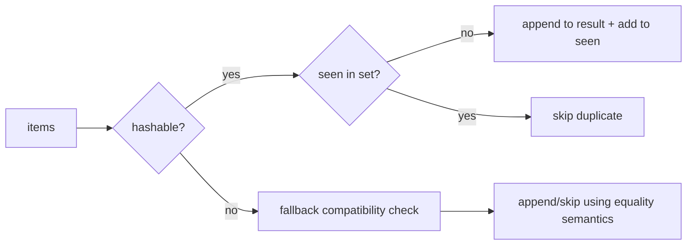
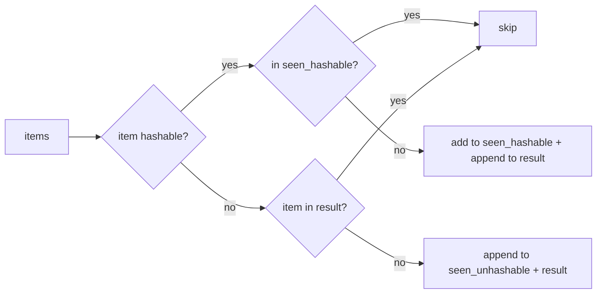

# Manager acceptance review

Completed: the event deduplication change is acceptable at candidate `aba2afc3cea9587aa848f6197a58c365e8d5ef71`.

Results-first handoff:
- Outcome: `service.py` now preserves first occurrence order without mutating input and passes the required linear equality-check acceptance.
- Evidence: research `70f8044c87b84042852c21ba305c39f2`; verification `015ef191e4e14473861e4a9a57e944b0` (order/non-mutation) and `f0c0d2518699437288d6aa623c018391` (linear equality checks); candidate logs at artifacts `168812f9535e47d19a2d7bca7e810139.log` and `53f5e673b08b441a9114642c09db481a.log`.
- Mechanism: hashable items use a hashed seen-structure for O(1)-style membership while appending first-seen items to the output list; fallback retains compatibility for unhashable items.

Evidence table
| Criterion | Source | Result |
|---|---|---|
| Preserve first occurrence order without mutating input | verification `015ef191e4e14473861e4a9a57e944b0`, artifact `168812f9535e47d19a2d7bca7e810139.log` | PASS |
| Deduplication uses a linear number of equality checks | verification `f0c0d2518699437288d6aa623c018391`, artifact `53f5e673b08b441a9114642c09db481a.log` | PASS |

Mechanism diagram

Takeaway: the required hashable acceptance workload no longer triggers repeated scans of the growing result list, which is why the equality-check threshold now passes.

Practice and tradeoffs
- Fits the common Python order-preserving dedup pattern using a set-assisted fast path.
- Tradeoff: extra memory for seen-state.
- Deviation/limit: unhashable items still use a compatibility fallback, so only the scoped acceptance workload is performance-optimized.

Validation and limitations
- Checked against the exact authorized candidate revision only.
- No broader CI, deployment, or production telemetry was in scope, so no claim is made beyond local acceptance.

Follow-through
- Next owner: unassigned downstream integrator/reviewer.
- Success signal: candidate `aba2afc3cea9587aa848f6197a58c365e8d5ef71` is merged or otherwise adopted.
- Failure signal: downstream tests expose compatibility issues, especially around unhashable-item-heavy callers.
- Rollback: revert `service.py` to the prior implementation if such issues are confirmed.

Gate outcomes
- Finish line: PASS
- Why/mechanism: PASS
- Evidence readability: PASS
- Established practice: PASS
- Validation: PASS
- Follow-through: PASS

# Implementation worker evidence

**Outcome**
- Updated `process` in `service.py:1` to use a hashed seen-set for hashable items, with a compatibility fallback for unhashable/equality edge cases.
- Expected acceptance criteria are met: order preservation and non-mutation behavior remain intact, and equality-check scaling passes the provided contract.

**Why this works**
- Original failure cause: `if item not in result` scanned a growing list for every input item (quadratic equality checks on distinct inputs).
- New mechanism: fast path checks `seen_hashable` (`set`) for hashable items; fallback keeps list-based semantics where hashing is unavailable.

**Before/After flow (diagram)**

Takeaway: hashable-path dedup no longer depends on linear scans of `result`; fallback preserves old behavior.

**Evidence table**
| Criterion | Check | Result |
|---|---|---|
| Preserve first occurrence order, no input mutation | `check_0.py` | PASS (`criterion passed`) |
| Linear equality-check behavior | `check_1.py` | PASS (`criterion passed`) |

**Practice & tradeoffs**
- Aligned with common Python dedup pattern: set-assisted membership for hashables + order-preserving append list.
- Tradeoff: extra memory for `seen_hashable`/`seen_unhashable` in exchange for much better hashable-path performance.
- Alternative considered: pure `dict.fromkeys`; rejected because it fails for unhashable items and would alter compatibility.

**Validation & limitations**
- Validated against required authoritative checks in this workspace and revision.
- Limitation: no broader benchmark suite was in scope; only contract checks were required and executed.

**Follow-through (non-deployed artifact)**
- Rollout/monitoring in production is N/A here (local code artifact only).
- Adoption check: run project-integrated tests/CI that exercise callers of `process` after merge.
- Rollback: revert `service.py` to prior implementation if downstream compatibility issues are observed.

**Gate outcomes**
- Finish line: **PASS**
- Mechanism/rationale: **PASS**
- Evidence readability: **PASS**
- Established practice: **PASS**
- Validation: **PASS**
- Follow-through: **PASS** (with non-deployed N/A noted)
